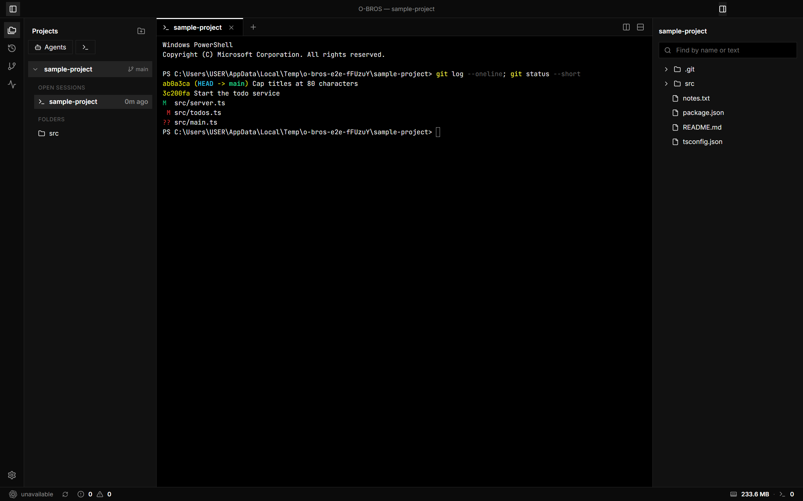
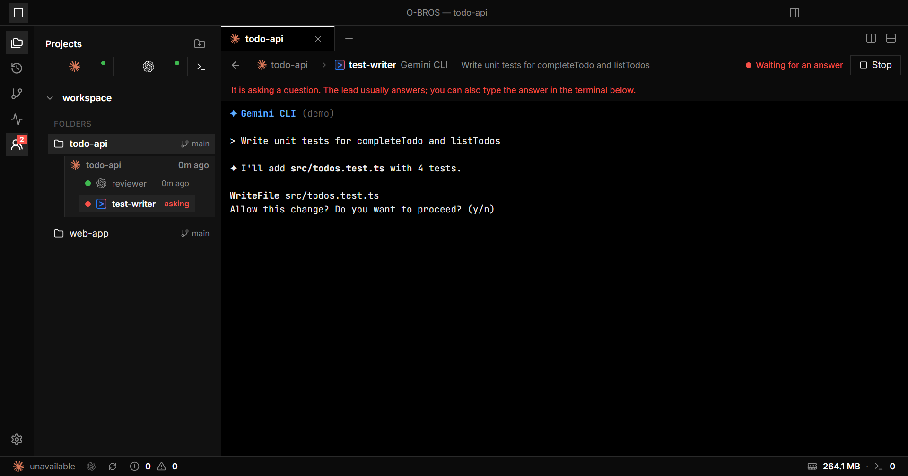
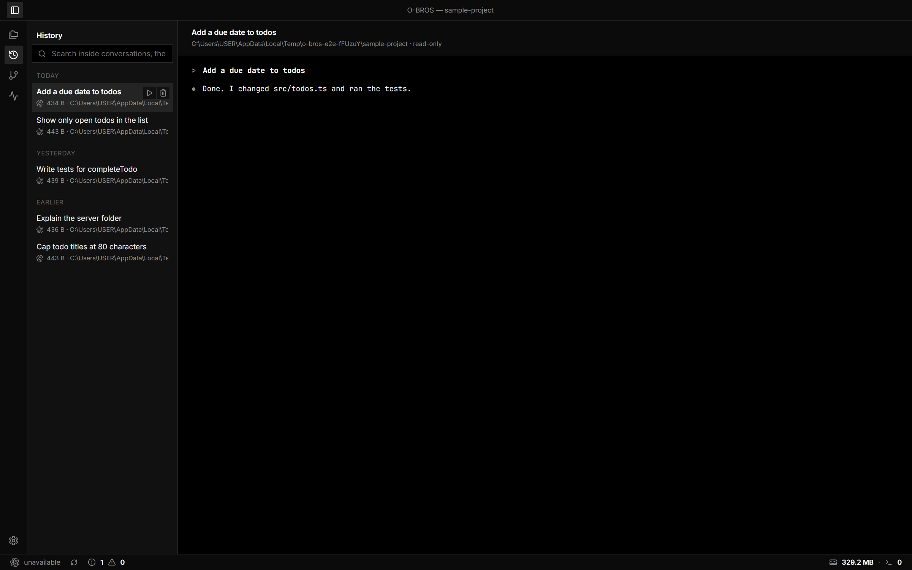
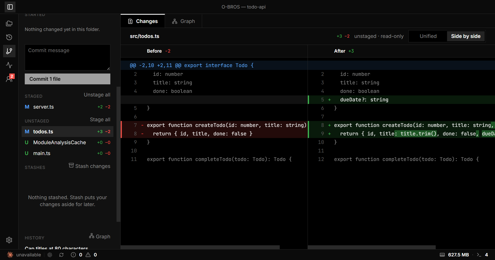
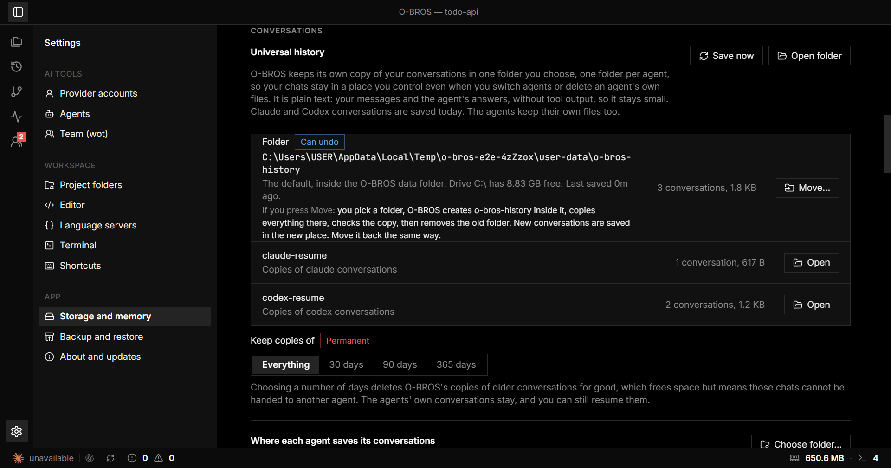
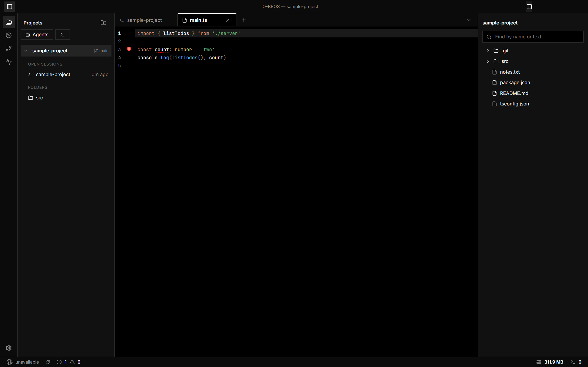
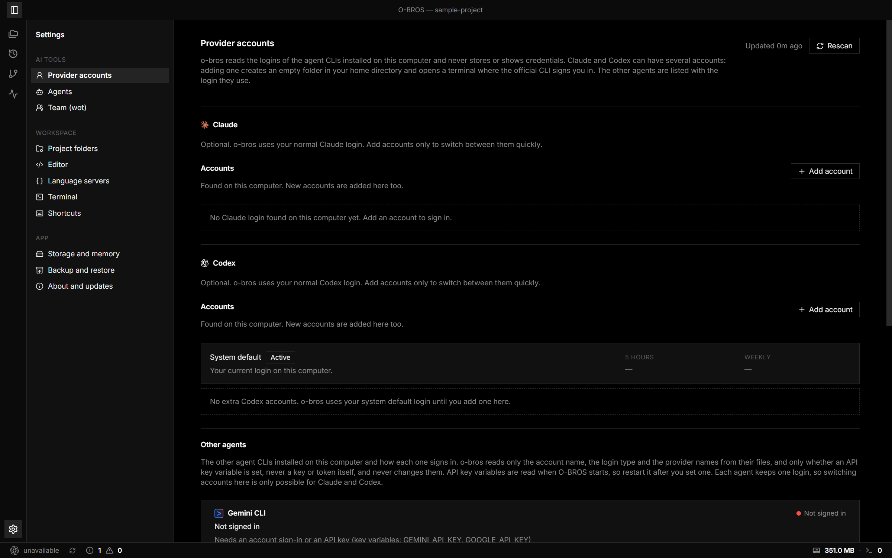

<p align="center">
  
</p>

<h1 align="center">O-BROS</h1>

[](https://github.com/Lio3307/O-Bros/actions/workflows/ci.yml)

A terminal-first desktop workspace for the **Claude** and **Codex** command-line tools.

o-bros puts real terminals, a code editor, git changes, session history and your usage limits in one window, and it keeps memory use low by doing most work only when you ask for it.

> **Status:** early version. Built and tested on Windows 11. macOS and Linux code paths exist but have not been tested. Installers are built by a release workflow once a version is published; until then you run it from source.

## Screenshots



| Team member view | Continue in another agent |
|---|---|
|  |  |

| Git changes, side by side | Storage you control |
|---|---|
|  |  |

| Editor with linting | Provider accounts |
|---|---|
|  |  |

## What you get

- **Real terminals** with tabs and splits (xterm.js and node-pty). Start `claude`, `codex` or a plain shell in any project folder.
- **Accounts and usage.** Shows every agent CLI you have installed and how it signs in (account or API key). Claude and Codex accounts can be switched, and their 5-hour and weekly usage shows in the status bar.
- **Files and editor.** A file tree with a right-click menu, name and text search, quick open (`Ctrl+P`) and a CodeMirror editor with code intelligence from the language servers you have installed (completions, hover, errors, go to definition), linting and formatting for JavaScript and TypeScript, auto save and 14 languages.
- **Git changes.** Stage, unstage, discard and commit, switch branches, fetch, and read diffs.
- **Team of agents (wot).** Ask your agent to bring in another one by name ("ask gemini to review this"). It summons any agent CLI installed on your computer; members show under the terminal that summoned them in Projects, where you can watch and stop them.
- **Session history and Resume.** Browse, search, resume and delete your Claude and Codex conversations (the transcript formats O-BROS can read; other agents keep their own history).
- **Development helpers.** Run `package.json` scripts, see problems from the linter, see and stop listening ports, and get a notification when a long command finishes.
- **Resource Manager.** See how much memory and CPU each terminal and the app use.
- **Storage and memory.** One settings page that shows what is safe to clear (app cache, leftover temp files, terminal history, recent files) and clears it with a button.

## Download

Installers for Windows, macOS and Linux are attached to each version on the [Releases page](https://github.com/Lio3307/O-Bros/releases). The app is not code-signed yet, so Windows may show a SmartScreen warning and macOS will ask you to confirm opening it. Updates are checked only when you press the button in Settings → About and updates, and **Restart and install** reopens the app by itself; anything still running in a terminal stops, and your tabs come back in the same folders. Uninstalling removes the program but keeps your settings, so a reinstall keeps your setup. Settings → Storage and memory shows every folder o-bros uses.

## Quick start

You need [Node.js](https://nodejs.org) and [git](https://git-scm.com). Any agent CLI you use (Claude Code, Codex, Gemini CLI, OpenCode, Kilo, Cline and others) is optional but is the point of the app.

```
git clone https://github.com/Lio3307/O-Bros.git
cd O-Bros
npm install
npm run dev
```

Then choose **Open a folder** in the Projects panel and press **Claude**, **Codex** or the terminal button.

If `npm install` leaves Electron without its binary, run `node node_modules/electron/install.js`.

## Scripts

| Command | What it does |
|---|---|
| `npm run dev` | Starts the app with hot reload |
| `npm run build` | Builds the main, preload and renderer bundles into `out/` |
| `npm run typecheck` | Type-checks the main side and the renderer |
| `npm test` | Runs the unit tests |
| `npm run lint` | Lints the code and the end-to-end tests with oxlint |
| `npm run check` | Type check, lint, unit tests and build in one go |
| `npm run package` | Builds installers into `release/` |

## Keyboard shortcuts

| Keys | Action |
|---|---|
| `Ctrl+P` | Quick open a file by name (shows recent files when empty) |
| `Ctrl+F` | Search inside the focused terminal |
| `Ctrl` `+` / `-` / `0` | Zoom terminal text in, out, reset |
| `Ctrl+S` | Save the open file (formats first if enabled) |
| `Shift+Alt+F` | Format the open file |
| `Ctrl+Shift+D` / `Ctrl+Shift+E` | Split the focused terminal right / down (change them in Settings, Shortcuts) |
| `Ctrl+Shift+W` / `Ctrl+Shift+T` | Close the focused pane / open a new terminal |
| `Ctrl+Shift+P` | Command palette: search and run any action |
| `F2` / `Del` | Rename / delete the selected item in the file tree |

## Documentation

| Document | For |
|---|---|
| [Getting started](docs/GETTING-STARTED.md) | First run, step by step |
| [Features](docs/FEATURES.md) | Every feature and every setting |
| [Architecture](docs/ARCHITECTURE.md) | How the app is built |
| [Development](docs/DEVELOPMENT.md) | Working on the code |
| [Privacy and security](docs/PRIVACY-AND-SECURITY.md) | What o-bros reads, writes and sends |
| [Decisions](docs/decisions.md) | Why things are the way they are, and known risks |
| [Contributing](CONTRIBUTING.md) | How to propose a change |

## Privacy

O-BROS has no account, no analytics, no crash reporting and no server of its own. Nothing about you, your projects or your conversations is sent to the people who make O-BROS.

- **What leaves your computer**, and only to the service it belongs to: your own Claude and Codex logins go to Anthropic and OpenAI to read your plan usage, an OpenRouter key (if you have one) goes to OpenRouter for its balance, a custom provider's key goes to the address you entered when you press **Test connection**, `git` talks to your own remotes, and O-BROS asks GitHub whether a new version exists and downloads the public list of agents and their logos.
- **What stays on your computer**: your settings, open tabs and window size, a short activity log, copies of your Claude and Codex conversations (the universal history, so they can be resumed), images you paste into a terminal (deleted after 7 days), the app log, and API keys you paste for custom providers, which are encrypted with your system's protection.
- **What O-BROS never does**: it never asks for or stores your password, never copies or rewrites your agents' login files, never sends a login anywhere except the provider that issued it, and never logs one.

Uninstalling leaves O-BROS's data folder in place, so your settings come back if you reinstall. Delete it yourself to remove everything. Every file and every connection is listed in [Privacy and security](docs/PRIVACY-AND-SECURITY.md).

## Known limits

- Usage numbers come from endpoints the providers do not document. They may change or stop working.
- Formatting uses `oxfmt`, which is not yet 1.0, and supports JavaScript, TypeScript, JSON, CSS, HTML, Markdown and YAML only.
- Resume starts `claude --resume` or `codex resume` in a terminal and relies on the CLI finding the session; if the project folder was moved or deleted, resume will not work.
- Installers are not code-signed. macOS cannot auto-update an unsigned app (download manually). See [Development](docs/DEVELOPMENT.md).

## License

MIT. See [LICENSE](LICENSE). The built-in theme colors include color schemes from iTerm2-Color-Schemes; see [THIRD-PARTY-NOTICES.md](THIRD-PARTY-NOTICES.md).
