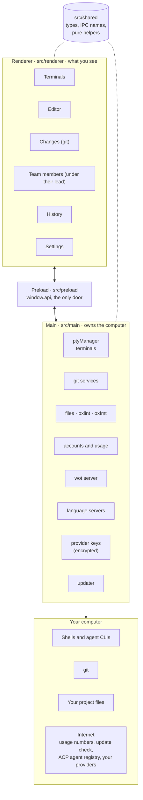
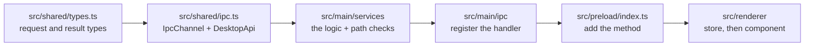
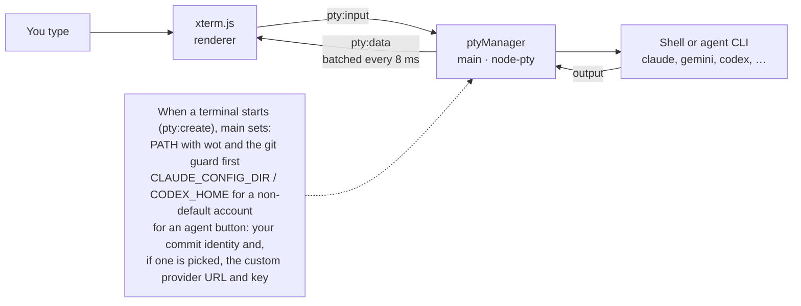
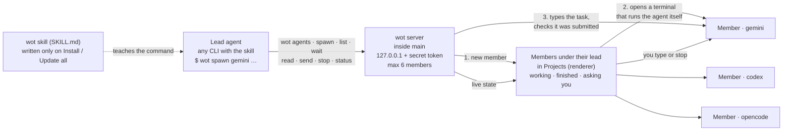
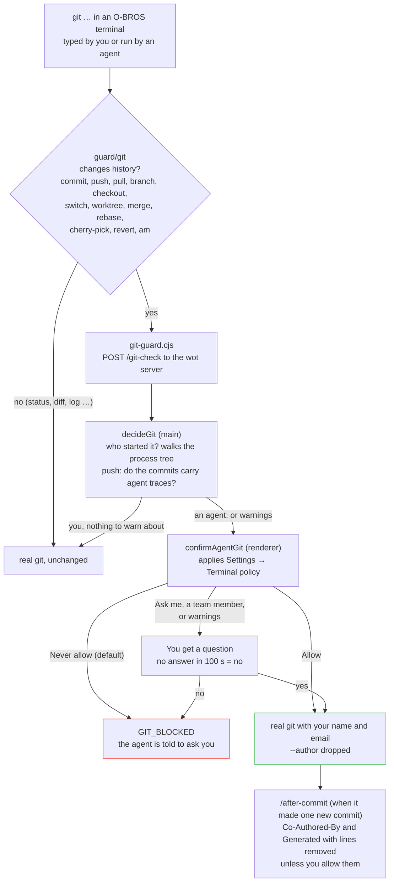
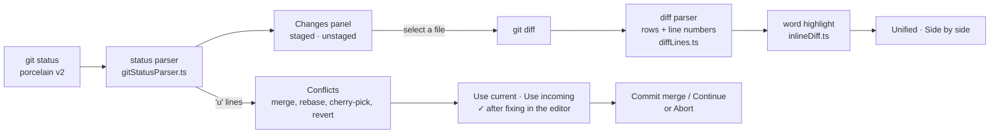
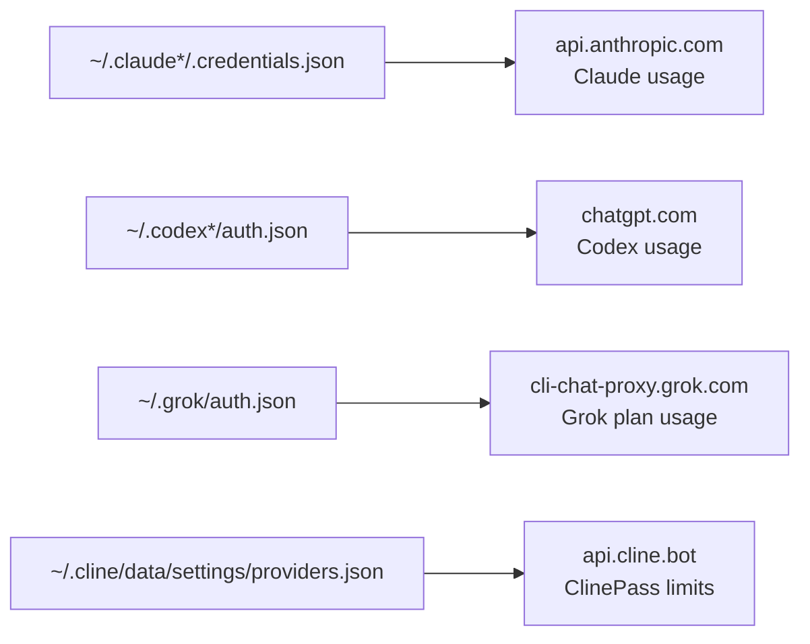
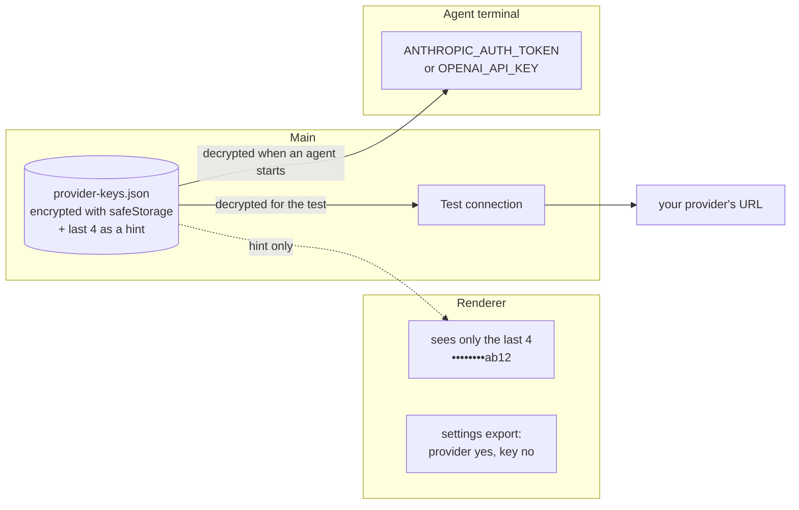

# Architecture

o-bros is an Electron app written in TypeScript. This page explains how the pieces fit together so you can find your way around the code. The diagrams are drawn with Mermaid, which GitHub shows as pictures.

## The big picture

| Process | Folder | Responsibility |
|---|---|---|
| Main | `src/main` | Everything that touches the operating system: terminals, files, git, process tables, accounts, usage requests, the wot server and language servers. |
| Preload | `src/preload` | A thin bridge. It turns each IPC channel into a function on `window.api`, and each event into an `on…` function that returns its own unsubscribe. The one call that skips IPC is `files.pathOf`, which asks Electron for the path of a dropped file. |
| Renderer | `src/renderer` | The React interface. It never imports Node. It can only ask the main process for things through `window.api`. |
| Shared | `src/shared` | Types, IPC channel names and pure helper functions used by both sides. Most unit tests live here. |

The window is created with `contextIsolation` on, `nodeIntegration` off and the sandbox on.

## What happens at start

`src/main/index.ts` runs these steps in order:

1. Pick the data folder, and turn off the graphics card if you chose that in Settings (it must happen before Electron is ready).
2. Register every IPC handler (`src/main/ipc/*`). Each `ipcMain.handle` goes through `handlerErrors.ts`, which refuses calls that do not come from the O-BROS page (`trustedSender.ts`) and logs failures.
3. Start the wot server on a free port of `127.0.0.1`.
4. Open the window and connect the bridge that lets main ask the window questions.
5. Start watching for agents you start by typing their name in a plain terminal, so Activity can show them (`typedAgents.ts`).

On quit, main stops the wot server, every terminal and every language server. Closing the window first asks the renderer, which can warn about unsaved files and running tasks (`closeGuard.ts`).

### Running from source and the installed app

`src/main/runMode.ts` is the only place that tells them apart, and it uses `app.isPackaged`, which an environment variable cannot change.

| | Running from source (`npm run dev`, e2e) | Installed app |
|---|---|---|
| Data folder (settings, open tabs, localStorage, provider keys, logs, activity) | `%APPDATA%/o-bros-dev` | `%APPDATA%/o-bros` |
| Page loaded | The dev server in `ELECTRON_RENDERER_URL`, or the built page | Always the built page; `ELECTRON_RENDERER_URL` is ignored |
| DevTools and Reload | In the View menu | Turned off (`devTools: false`) |
| Background errors | Logged and shown as a "Dev:" toast | Logged only |
| Updates | Not checked | Checked on GitHub |

e2e tests pass their own `--user-data-dir`, so they never touch either folder. The wot task folder in the system temp folder is shared; its files are short-lived and uniquely named.

The installer sets Electron fuses in `electron-builder.yml`: `NODE_OPTIONS` and `--inspect` are ignored and cookies are encrypted. `runAsNode` stays on because wot, the git guard and the lint tools run `O-BROS.exe` as Node (`ELECTRON_RUN_AS_NODE`); that is the one fuse an attacker who can already run programs on the computer could still use.

## The IPC contract

All communication is declared once, in `src/shared/ipc.ts`:

- `IpcChannel` lists every channel name.
- `DesktopApi` describes `window.api`: one group per area (`pty`, `files`, `git`, `wot`, `history`, `accounts`, `usage`, `projects`, `backup`, `resources`, `tools`, `agents`, `shell`, `ports`, `lsp`, `activity`, `storage`, `updater`, `app`).

Messages also go the other way. Main pushes events to the window: terminal output (`pty:data`, `pty:exit`), team changes (`wot:members`), new activity, update status and the close request. Through `rendererBridge.ts` it can also ask the window something (`wot:request`) and wait for the answer (`wot:respond`): "may this agent commit?", "what is on this member's screen?" or "which agent buttons exist?".

Adding a capability touches the same chain every time:

For example, conflict resolution touched exactly these files: `types.ts`, `ipc.ts`, `gitConflicts.ts`, `gitIpc.ts`, `preload/index.ts`, `changesStore.ts` and `ConflictSection.tsx`. The full checklist, with tests, is in [Development](DEVELOPMENT.md).

## How a terminal works

1. `TerminalView` creates an xterm.js `Terminal` and asks the main process for a PTY with the same id (`pty:create`).
2. `ptyManager` spawns the shell with node-pty, batches output every 8 ms and sends it back.
3. Keystrokes go to the PTY; resize events follow the pane size.
4. A non-default account is selected only by setting `CLAUDE_CONFIG_DIR` or `CODEX_HOME` on the spawned process.
5. Every terminal gets the `wot` command at the front of its `PATH`, and the git guard in front of that when O-BROS found the real git program (`wotEnvironment.ts`).

## How wot (the team) works

wot lets the agent you talk to summon other agents. Any agent CLI on the computer can lead or be summoned.

- You ask in your own words, for example "ask gemini to review login.ts". The skill tells the lead agent to run `wot`, which every O-BROS terminal has on its `PATH`.
- `wot` talks to a small HTTP server inside the main process that listens only on `127.0.0.1` and needs a random key that only O-BROS terminals receive. Outside O-BROS, `wot` answers that it needs the app. The CLI refuses options a command does not know; arguments after `--` go to the agent, quoted for the shell (`shellCommand.ts`).
- `spawnMember` (`teamRegistry.ts`) adds the member and tells the window, which opens its terminal through the normal `pty:create` path. A member terminal runs the agent as the shell's one command (`powershell -Command` or `sh -c`), so when the agent exits, the terminal exits and the member is "exited". If that happens before the task is sent, `wot spawn` fails with the agent's last screen instead of typing the task into a shell.
- Typing a task: the text is pasted, wot waits until the agent stops redrawing it, presses Enter, and counts output over the next 3 seconds. A working agent keeps drawing; if it did not, Enter is pressed once more, never when the screen shows a question. This was measured with Codex, which needs a second Enter after a large paste.
- Every O-BROS terminal starts from a cleaned environment (`terminalEnvironment.ts`): `CODEX_HOME` and `CLAUDE_CONFIG_DIR` are removed so the account chosen in O-BROS applies, and the session variables of a terminal app that started O-BROS (`ORCA_*`, `TERM_PROGRAM`) are dropped. Without this, O-BROS started from an Orca terminal gave every Codex Orca's private Codex home and its daemon, which failed with "Access is denied".
- The lead is never interrupted: it asks with `wot wait`. A member's state comes from its terminal (`memberState.ts`): no output for 5 seconds means finished or, if the screen shows a known prompt, waiting. `teamRegistry.ts` marks a member "unreported" whenever its state changes into finished, waiting or exited; `wot wait <name>`, `wot read` and `wot wait --any` clear it, and `--any` refreshes the states of the lead's members itself before each check so it never sees a stale state.
- Members are real terminals. They show nested under the session that summoned them in Projects; clicking one shows it in the main area (`TeamMemberViews.tsx`, `teamStore.shownMemberId`). When one asks a question, the rail number turns red. A member cannot summon more members.
- The code is in `src/main/services/wot` (server, routes, member state, skill installer) and `src/renderer/features/team`.

## How the git guard works

Agents must not commit, push or change branches as you without your say. Every O-BROS terminal has a small `git` program (`resources/wot/guard`) in front of the real one on its `PATH`.

- `guard/git` only checks the subcommand. Everything that does not change history goes straight to the real git, so normal commands stay fast. `git.cmd` on Windows hands every command to `git-guard.cjs`, which makes the same check: a batch `for` loop over `%*` runs zero times when the arguments have an odd number of quotes, so it would have let such commands skip the guard. This costs about 100 ms per git command in PowerShell and cmd.
- O-BROS tells an agent's git from yours by walking the process tree from the guard to the program that started it (`agentCaller.ts`). Your own commands are allowed as they are, except a push whose commits still have an agent author or credit line: then you are asked first. The Push button in the Changes panel makes the same check.
- The decision is split in two: the main process finds out who is asking and what to warn about (`gitDecision.ts`), and the renderer applies your policy and asks the question (`confirmAgentGit.ts`, with the rules in `src/shared/agentGitPolicy.ts`).
- If O-BROS cannot be reached, the guard refuses rather than letting the command through. Outside O-BROS the guard is not on the `PATH` at all.
- On Windows, `git.cmd` saves `%CMDCMDLINE%` (with delayed expansion, so nothing in it runs) in `O_BROS_CMD_LINE`. When it holds a line break, Windows has already cut `%*` at that break, so `git-guard.cjs` refuses the command instead of running the shortened one.

### gh and glab

`resources/wot/host-guard` puts `gh` and `glab` (and `.cmd` versions) first on every O-BROS terminal's `PATH`. Unlike the git wrapper, they hand every call to `host-guard.cjs`, which finds the real program further down the `PATH` (on Windows only an `.exe`, so arguments never pass through `cmd.exe` again) and asks `POST /host-check`.

- `src/shared/hostGuard.ts` decides what changes something: the first words after the group (`pr merge`, `repo deploy-key add`), API calls by method and fields, `auth token` and `--show-token`, and `config get token`. `auth status` and `auth git-credential` (git's credential helper) always run.
- `hostDecision.ts` (main) lets reading commands through at once. For the rest it finds out whether an agent started it, and `confirmAgentHost.ts` (renderer) applies Settings → Integrations → Agents and gh or glab (default Ask me) with the same rules as git (`agentGitPolicy.ts`).
- Unless the user lets agents add themselves as co-author, credit lines are removed from every argument, and a `--body-file` or `--notes-file` with credit lines becomes `--body` or `--notes` with the cleaned text.
- When gh or glab is not installed, the wrapper says so and points to Settings → Integrations.

## How the Changes panel works

- The panel shows the repository in `gitRepositoryStore.ts`: the selected project, or a repository you picked in the switcher at the top. Picking one there does not change the selected project or the terminal tabs, and the command palette's fetch, pull and push use the same repository.
- The status parser and the diff parser split text by hand; there are no regular expressions.
- In a diff, each removed line is compared word by word with the added line in the same place, and only the changed words get the strong colour. A line rewritten completely stays plain red and green.
- Conflicts come from the unmerged (`u`) lines of `git status` and the state files in the git folder (`MERGE_HEAD`, `rebase-merge` or `rebase-apply`, `CHERRY_PICK_HEAD`, `REVERT_HEAD`). The code is in `src/main/services/gitConflicts.ts` and `src/renderer/features/changes/ConflictSection.tsx`.

## Keys and tokens

O-BROS never signs in for you and never edits an agent's login. It touches secrets in exactly two ways.

**1. Usage numbers.** To show your plan usage, main reads a login that a CLI already saved and sends it only to the provider that issued it. Nothing is stored or passed on.

**2. Custom providers.** A key you paste in Settings → Provider accounts is the only secret O-BROS keeps.

- The full key never reaches the renderer, a log or an export. If the computer cannot encrypt, the key is not saved.
- The provider list (name, URL, model) lives in the renderer's `localStorage` and is part of the settings export; the keys are not.
- For every other agent, O-BROS reads only the account name, the login type and provider names from its files, and checks that a key variable is set without reading its value (`src/shared/agentLogins.ts`).
- Details are in [Privacy and security](PRIVACY-AND-SECURITY.md).

## Main process layout

| Folder | What lives there |
|---|---|
| `src/main/ipc` | One small file per area. Each only registers handlers and calls a service. |
| `src/main/services` | The real work: `ptyManager`, `fileService`, `entryService`, `gitService`, `gitActions`, `gitConflicts`, `accountScanner`, `scriptService`, and so on. |
| `src/main/services/wot` | The team server, its routes, member state, the skill installer and the git guard decisions. |
| `src/main/services/usage` | Reading each provider's saved login and asking for usage numbers. |
| `src/main/services/sessions` | Reading saved Claude and Codex conversations for History. |
| `src/main/services/languageServers` | Starting and stopping language servers for the editor. |
| `src/main/services/customProviders` | Encrypted provider keys and Test connection. |
| `src/main/services/resources` | Process table, resource snapshot, listening ports, background process detection. |
| `src/main/services/tools` | Running the bundled `oxlint` and `oxfmt` command-line tools. |
| `src/main/services/updater` | Checking GitHub for a new version. |
| `src/main/pathGuard.ts` | Refuses any file path outside the folders you added. |
| `src/main/closeGuard.ts` | Holds a window close until the renderer confirms. |

## Renderer layout

| Folder | What lives there |
|---|---|
| `src/renderer/shell` | The frame: title bar, rail, side panel, main area, status bar. |
| `src/renderer/features` | One folder per feature: `terminal`, `files`, `editor`, `changes`, `team`, `history`, `activity`, `commands`, `projects`, `settings`, `resources`, `problems`, `shutdown`. |
| `src/renderer/state` | Zustand stores. A store holds data and actions; it has no markup. |
| `src/renderer/ui` | Small shared components: buttons, dialogs, popup menus, toasts, cards, chips and badges (listed below). |
| `src/renderer/styles` | Design tokens and base styles (black and white, no gradients, square corners). |
| `src/renderer/theme` | Colour themes for the terminal and the editor (O-BROS, One Dark, Dracula, GitHub Dark, Monokai, Solarized Dark …). The rest of the interface keeps its own colours. |

### Shared components (`src/renderer/ui`)

Use these before writing new markup, so every screen looks and behaves the same.

| Component | Use it for |
|---|---|
| `Button` | Every button. Variants: `outline`, `primary`, `icon`, `link`, `remove`, `plain`. Defaults to `type="button"`. Spam-safe: it ignores a second click within 350 ms, and when `onClick` returns a promise it is disabled until that promise settles, so return the promise from long actions (`onClick={() => save()}`, not `void save()`). |
| `Modal` | Every dialog: backdrop, title, content and action buttons. Pass `onEscape` to close it with the Escape key, and `onSubmit` to make it a form. |
| `SettingsPageLayout` | The title, description and header buttons of a settings page. |
| `SettingsSection` | A titled block inside a settings page, with an optional description and action. |
| `SegmentedControl` | A row of choices where one is selected (Unified or Side by side diff, editor and terminal settings, usage view). |
| `PanelHeader`, `PopupMenu`, `RefreshButton`, `EditableTitle` | Side panel header, right-click and popup menus, refresh buttons, rename in place. |
| `AgentIcon`, `AgentStatusBadge`, `ProviderMark` | Brand marks and the Connected / Signed in status. |
| `Card`, `StatTile`, `Chip`, `StatusDot`, `AgentStateBadge`, `OutcomeBadge`, `AgentName`, `Spinner`, `LoadingText`, `Dropdown`, `UsageBar` | Boxes, numbers, small labels, state colours, loading states, select menus and usage bars. |

A page with more than about 150 lines is split into one component per file in a folder next to it, as `features/settings/agents/` does for the Agents page.

### State

Each store is a small Zustand store with one job (`workspaceStore` for tabs, `projectsStore` for folders, `changesStore` for git, `teamStore` for wot members, `toastStore` for messages, and so on). Components read from stores with selectors; stores call `window.api`.

### What is saved, and where

| Data | Where |
|---|---|
| Project folders, graphics card setting, chosen conversation folder | `settings.json` in the user-data folder (`%APPDATA%/o-bros` on Windows, `o-bros-dev` when running from source) |
| Universal history | `o-bros-history/<agent>-resume/<day>_<session id>.json` in the user-data folder or where the user moved it, plus `index.json` (source file → modified time and record file, relative paths). `universalHistory/historySync.ts` saves changed Claude and Codex transcripts (user and assistant text only) every minute and prunes by the keep period; `universalHistory.ts` runs each save in a worker thread (`historyWorker.ts`, started through `historySyncJob.ts`), so reading large transcripts never blocks the main process, and runs it one task at a time with Move, which copies with `copyAndCheck`, switches the setting, then removes the old folder. |
| Threads (Continue with…) | `threads.json` next to the universal history. `universalHistory/continuation.ts` saves the history, links earlier Codex parts by marker (`findTeamSessionId`), adds the new part (`historyThreads.ts`), builds the text (`handoff.ts`) and returns it with the command (`--session-id` for Claude). The renderer opens the terminal and calls `pty.typeWhenReady`, which reuses the wot typing in `terminalTyping.ts`. |
| Agent conversations you moved | `<chosen folder>/<agent>`, with a junction (Windows) or symlink in the agent's old folder. Done by `folderMove.ts`: rename the old folder (fails if a file is in use), copy and compare file count and bytes, link, then delete the old copy; any failure puts the files back. `conversationFolders.ts` refuses while the agent's process runs or the target lacks space. |
| Custom provider keys | `provider-keys.json` in the user-data folder, encrypted |
| Activity log | `activity.json` in the user-data folder |
| Team member conversations (to find them in History) | `team-sessions.json` in the user-data folder |
| ACP agent registry and agent icons | `acp-registry.json` and an icon folder in the user-data folder (a cache) |
| Error log | Electron's logs folder |
| Every other setting: editor, terminal, theme, shortcuts, agent buttons, custom providers (without keys), git policy, session, recent files | Browser `localStorage` of the renderer, under keys that start with `o-bros.` |
| wot task files | `o-bros-wot` in the system temp folder, deleted after use |
| Terminal output, file contents, git data | Not stored. Read on demand. |

## How memory stays low

- A terminal is created when its tab is first shown, not when it is restored.
- The WebGL renderer is released while a terminal is hidden.
- Scrollback is limited (default 2,000 lines) and configurable.
- The editor and every language pack are loaded on demand.
- A language server starts only when you open a file it handles, and stops a minute after its last file closes. No file watcher or search index runs in the background.
- Linting and formatting run as short-lived processes.
- Search and process lists are computed when asked for.
- Panels stay current without file watchers: `useLiveRefresh` re-reads only the panel on screen (Changes, Files, Projects) every 4 seconds and when the window gets focus, and pauses while the window is hidden. A refresh that finds nothing new changes nothing on screen. Commit history and the graph reload only when the branch, the current commit or the ahead and behind counts change. Repository lists, which can mean scanning a whole drive, are re-read on window focus only.

## Design rules

The code follows the rules in `AGENTS.md`: no comments, no regular expressions in logic, one responsibility per file, shared helpers instead of duplicates, and clear names. The reasons behind larger choices are recorded in [decisions](decisions.md).
