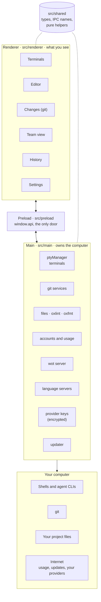
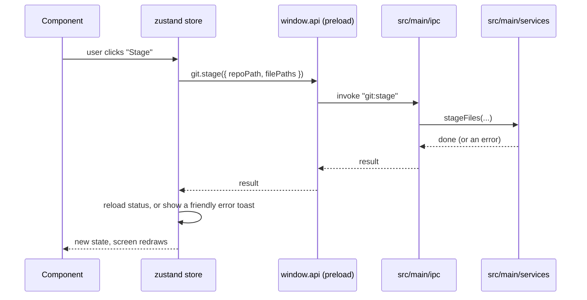
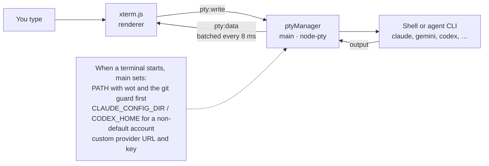
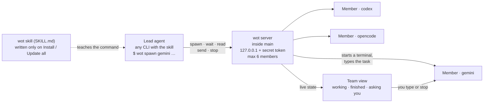
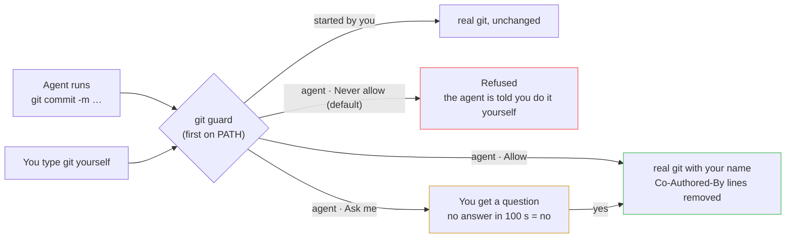
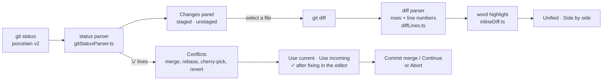
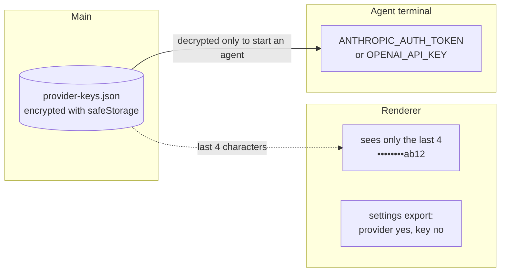

# Architecture

o-bros is an Electron app written in TypeScript. This page explains how the pieces fit together so you can find your way around the code. The diagrams are drawn with Mermaid, which GitHub shows as pictures.

## The big picture

| Process | Folder | Responsibility |
|---|---|---|
| Main | `src/main` | Everything that touches the operating system: terminals, files, git, process tables, accounts, usage requests, the wot server and language servers. |
| Preload | `src/preload` | A thin bridge. It turns each IPC channel into a function on `window.api`. It holds no logic. |
| Renderer | `src/renderer` | The React interface. It never imports Node. It can only ask the main process for things through `window.api`. |
| Shared | `src/shared` | Types, IPC channel names and pure helper functions used by both sides. Most unit tests live here. |

The window is created with `contextIsolation` on, `nodeIntegration` off and the sandbox on.

## The IPC contract

All communication is declared once, in `src/shared/ipc.ts`:

- `IpcChannel` lists every channel name.
- `DesktopApi` describes `window.api`: one group per area (`pty`, `files`, `git`, `wot`, `history`, `accounts`, `usage`, `projects`, `backup`, `resources`, `tools`, `agents`, `shell`, `ports`, `lsp`, `activity`, `storage`, `updater`, `app`).

Adding a capability always touches the same four places: the contract, the preload bridge, an `ipc` handler in `src/main/ipc`, and a service in `src/main/services`. See [Development](DEVELOPMENT.md).

## How a terminal works

1. `TerminalView` creates an xterm.js `Terminal` and asks the main process for a PTY with the same id.
2. `ptyManager` spawns the shell with node-pty, batches output every 8 ms and sends it back.
3. Keystrokes go to the PTY; resize events follow the pane size.
4. A non-default account is selected only by setting `CLAUDE_CONFIG_DIR` or `CODEX_HOME` on the spawned process.
5. Every terminal gets the `wot` command and the git guard at the front of its `PATH`.

## How wot (the team) works

wot lets the agent you talk to summon other agents. Any agent CLI on the computer can lead or be summoned.

- You ask in your own words, for example "ask gemini to review login.ts". The skill tells the lead agent to run `wot`, which every O-BROS terminal has on its `PATH`.
- `wot` talks to a small HTTP server inside the main process that listens only on `127.0.0.1` and needs a random key that only O-BROS terminals receive. Outside O-BROS, `wot` answers that it needs the app.
- Members are real terminals. When one asks a question, the Team button turns red.
- The code is in `src/main/services/wot` (server, routes, member state, skill installer) and `src/renderer/features/team`.

## How the git guard works

Agents must not commit, push or change branches as you without your say. Every O-BROS terminal has a git guard in front of the real git program.

- O-BROS tells an agent's git from yours by checking which program started the command.
- Before any push, O-BROS checks the commits for an agent author or credit line and asks you first.
- The code is in `src/main/services/wot` (`gitDecision`, `commitCredits`, `pushTraces`, `realGit`) and `src/shared/agentGitPolicy.ts`.

## How the Changes panel works

- The status parser and the diff parser split text by hand; there are no regular expressions.
- In a diff, each removed line is compared word by word with the added line in the same place, and only the changed words get the strong colour. A line rewritten completely stays plain red and green.
- Conflicts come from the unmerged (`u`) lines of `git status` and the state files in the git folder (`MERGE_HEAD`, `rebase-merge`, `CHERRY_PICK_HEAD`, `REVERT_HEAD`). The code is in `src/main/services/gitConflicts.ts` and `src/renderer/features/changes/ConflictSection.tsx`.

## Where a provider key goes

O-BROS never reads the keys or tokens of other agents. The one exception is a custom provider key that you paste yourself.

- The key never reaches the renderer, a log or an export.
- For other agents, O-BROS only checks that a key variable is set. It never reads the value.
- Details are in [Privacy and security](PRIVACY-AND-SECURITY.md).

## Main process layout

| Folder | What lives there |
|---|---|
| `src/main/ipc` | One small file per area. Each only registers handlers and calls a service. |
| `src/main/services` | The real work: `ptyManager`, `fileService`, `entryService`, `gitService`, `gitActions`, `gitConflicts`, `accountScanner`, `scriptService`, and so on. |
| `src/main/services/wot` | The team server, its routes, member state, the skill installer and the git guard decisions. |
| `src/main/services/usage` | Reading each provider's saved login and asking for usage numbers. |
| `src/main/services/sessions` | Reading saved Claude and Codex conversations for History. |
| `src/main/services/languageServers` | Starting and stopping language servers for the editor. |
| `src/main/services/customProviders` | Encrypted provider keys and Test connection. |
| `src/main/services/resources` | Process table, resource snapshot, listening ports, background process detection. |
| `src/main/services/tools` | Running the bundled `oxlint` and `oxfmt` command-line tools. |
| `src/main/services/updater` | Checking GitHub for a new version. |
| `src/main/pathGuard.ts` | Refuses any file path outside the folders you added. |
| `src/main/closeGuard.ts` | Holds a window close until the renderer confirms. |

## Renderer layout

| Folder | What lives there |
|---|---|
| `src/renderer/shell` | The frame: title bar, rail, side panel, main area, status bar. |
| `src/renderer/features` | One folder per feature: `terminal`, `files`, `editor`, `changes`, `team`, `history`, `activity`, `commands`, `projects`, `settings`, `resources`, `problems`, `shutdown`. |
| `src/renderer/state` | Zustand stores. A store holds data and actions; it has no markup. |
| `src/renderer/ui` | Small shared components: popup menu, toasts, confirm dialog, buttons. |
| `src/renderer/styles` | Design tokens and base styles (black and white, no gradients, square corners). |

### Shared components (`src/renderer/ui`)

Use these before writing new markup, so every screen looks and behaves the same.

| Component | Use it for |
|---|---|
| `Button` | Every button. Variants: `outline`, `primary`, `icon`, `link`, `remove`, `plain`. Defaults to `type="button"`. Spam-safe: it ignores a second click within 350 ms, and when `onClick` returns a promise it is disabled until that promise settles, so return the promise from long actions (`onClick={() => save()}`, not `void save()`). |
| `Modal` | Every dialog: backdrop, title, content, action buttons and the Escape key. Pass `onSubmit` for a form. |
| `SettingsPageLayout` | The title, description and header buttons of a settings page. |
| `SettingsSection` | A titled block inside a settings page, with an optional description and action. |
| `SegmentedControl` | A row of choices where one is selected (lint mode, history lines, usage view). |
| `PanelHeader`, `PopupMenu`, `RefreshButton`, `EditableTitle` | Side panel header, right-click and popup menus, refresh buttons, rename in place. |
| `AgentIcon`, `AgentStatusBadge`, `ProviderMark` | Brand marks and the Connected / Signed in status. |

A page with more than about 150 lines is split into one component per file in a folder next to it, as `features/settings/agents/` does for the Agents page.

### State

Each store is a small Zustand store with one job (`workspaceStore` for tabs, `projectsStore` for folders, `changesStore` for git, `teamStore` for wot members, `toastStore` for messages, and so on). Components read from stores with selectors; stores call `window.api`.

### What is saved, and where

| Data | Where |
|---|---|
| Project folders | `settings.json` in the Electron user-data folder (main process) |
| Custom provider keys | `provider-keys.json` in the Electron user-data folder, encrypted |
| Editor settings, terminal settings, session, recent files | Browser `localStorage` of the renderer, under keys that start with `o-bros.` |
| Terminal output, file contents, git data | Not stored. Read on demand. |

## How memory stays low

- A terminal is created when its tab is first shown, not when it is restored.
- The WebGL renderer is released while a terminal is hidden.
- Scrollback is limited (default 2,000 lines) and configurable.
- The editor and every language pack are loaded on demand.
- A language server starts only when you open a file it handles, and stops a minute after its last file closes. No file watcher or search index runs in the background.
- Linting and formatting run as short-lived processes.
- Search and process lists are computed when asked for.

## Design rules

The code follows the rules in `AGENTS.md`: no comments, no regular expressions in logic, one responsibility per file, shared helpers instead of duplicates, and clear names. The reasons behind larger choices are recorded in [decisions](decisions.md).
